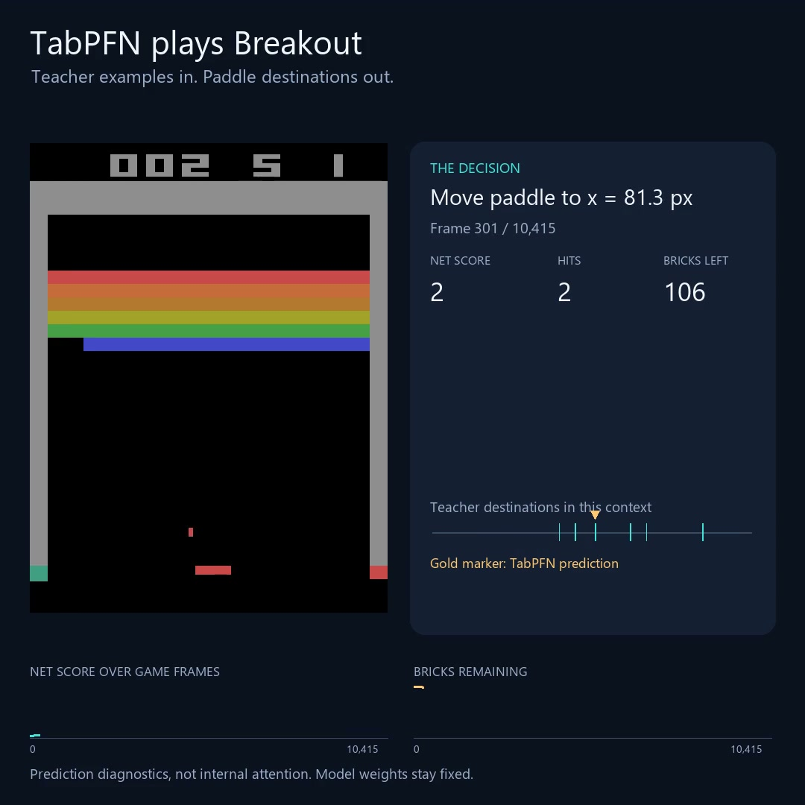

# TabPFN Breakout

TabPFN predicts a paddle destination every game frame from recorded teacher examples. A recorded run achieved **110 paddle hits, cleared all 108 bricks, and scored 432 points**, without live teacher intervention. This run used the teacher's starting conditions; reliable completion across different starts has not been established.

[](https://github.com/msalem7777/tabpfn-breakout/blob/main/media/level-clear-1x.mp4)

**Click the image to watch the complete level clear.** This is a verified replay of saved TabPFN decisions at normal game speed, not real-time model inference.

Inspired by [Goran Nakerst's TabPFN driving demonstration](https://jamblejoe.github.io/).

## What TabPFN does

The teacher is a simple, deterministic catching rule: project downward ball motion to paddle height, reflect side-wall bounces, and select a paddle center. During upward flight it follows the ball's horizontal position. It does not inspect bricks, simulate candidate shots, or optimize score. Its executed actions supply the labels in the bundled **23,917 unique-state examples**, collected across three episodes.

TabPFN receives **10 variables**: ball x/y position, ball x/y velocity, paddle x position/velocity, and the ball's and paddle's distances from both side walls. It predicts the desired horizontal paddle coordinate. A custom controller converts that coordinate to native ALE analog paddle input. It respects game movement and collisions; it does not teleport the paddle. Brick counts are measured for reporting and termination, not supplied to this policy.

Every frame uses a fresh model instance, one estimator and FP32 (32-bit numerical precision). `fit` supplies the examples; **no neural-network weights are updated**. No teacher intervenes during student play. Exact-match checks only record diagnostics; they never substitute stored labels for model predictions.

## Context selection is engineered

The teacher bank stays fixed. Our code selects up to **256 unique rows anew each frame**:

1. Require matching horizontal and vertical velocity signs. Zero is its own category.
2. Normally require each ball velocity component to be within **0.05 pixels/frame** of the current state. If needed, widen this only enough to obtain two direction-compatible rows; this is logged.
3. Rank eligible states by scaled squared differences across the six ball/paddle variables. Scaling uses each bank column's standard deviation with minimum scales to avoid division by zero. Ball-variable weights are **1**; paddle-variable weights are **0.25**.
4. Take nearest examples and eligible recorded neighbors within **eight teacher frames before/after** each anchor, within the same episode, until reaching 256 rows or exhausting eligible rows. Supply selected rows in their original bank order.

Selection never reads action labels or simulates the student's future. Recorded frame numbers only identify neighbors within existing teacher demonstrations, not matching times in the student run. The four wall-distance inputs are added after selection and are not separately weighted in retrieval. This selection procedure and state measurement are provided by our code, not learned by TabPFN.

## Limitations and unsuccessful approaches

Earlier experiments used a planning teacher with simulated candidate futures and brick objectives, direct imitation with brick inputs, separate motion/action predictors, failure-feedback examples, larger fixed contexts and downsampled frames. These did not establish reliable play. This package contains only the simplified ball/paddle workflow.

The successful run used a recorded teacher start. A tested new start failed on the first catch at frame 94 with both local and hosted TabPFN. A later brick-aware local run reached 12 hits before missing. These are selected experimental outcomes, not a controlled benchmark or evidence that any single modification caused success.

An audit of the successful run found accurate predictions for some ball states absent from the bank, including predictions distinct from all selected labels. That supports actual example-conditioned inference, but does not establish learned physics or superiority to simpler interpolation baselines. This is not reinforcement learning, pixel-based control, or uncertainty-aware planning; we execute a point prediction.

The video is a verified replay at normal game speed. Computing its **7,762 frames (about 129 seconds)** took approximately **4.14 hours** on an RTX 3070 Laptop GPU. The recorded result earned 406 game points; the logged net score is 405 after the miss penalty. Hardware and dependency differences can change new model predictions.

## Install and check

Use Python 3.12 and run commands from this repository's root. Install a CUDA-enabled PyTorch build suitable for your machine using the [official installer](https://pytorch.org/get-started/locally/) before installing the local option. Model access/download may require accepting Prior Labs' terms.

```powershell
python -m pip install -e ".[local]"
```

```powershell
python -m breakout_pfn.smoke
```

The smoke check uses no GPU, model download or API requests. The original run used ALE 0.12.1, Gymnasium 1.2.1 and TabPFN 9.0.0; the local extra pins TabPFN to that version. The GPU cap limits PyTorch allocations, not all driver allocations or other applications.

## Run TabPFN locally

The exact teacher bank and successful episode-0 initialization are bundled under `data/teacher`. No separate data download is required.

```powershell
python -m breakout_pfn.ball_paddle run --source data/teacher --episode 0 --run-dir runs/local_teacherstart --frames 20000 --context-mode local --context-motion compatible --velocity-tolerance-pixels 0.05 --local-context-rows 256 --context-window 8 --context-stride 1 --backend local --fresh-model-per-frame --local-n-estimators 1 --local-precision float32 --gpu-memory-gib 5 --gpu-headroom-gib 1 --model-path v3.5_default --model-seed 7 --student-controller analog-target --prediction-target absolute --log-every 10
```

This runs until a miss, level clear or frame limit. Existing output directories receive a numbered suffix; the actual directory is printed. Logs include predictions, selected row indices, controller actions, configuration and outcome. The context bank is not updated. To test a new start, supply **both** `--initial-seed` and `--initial-paddle-x`; successful generalization is not established.

## Optional hosted client

```powershell
python -m pip install -e ".[client]"
```

Authenticate using [tabpfn-client's instructions](https://github.com/PriorLabs/tabpfn-client). Requests consume your service allowance.

```powershell
python -m breakout_pfn.ball_paddle run --source data/teacher --episode 0 --run-dir runs/client_teacherstart --frames 20000 --backend client --context-mode local --context-stride 1 --client-fit-mode fit_preprocessors --client-n-estimators 1 --model-path v3.5_default --model-seed 7 --student-controller analog-target --log-every 10
```

The client creates a fresh estimator with the selected context each frame. Hosted numerical settings are not asserted to match local FP32 execution.

## Collect a new teacher bank

```powershell
python -m breakout_pfn.ball_paddle collect --source data/teacher --run-dir runs/new_teacher --episodes 3 --episode-frames 20000 --rows 0 --student-controller analog-target
```

Collection uses the actual game engine, labels visible states with the unchanged catching rule and retains all unique states. It starts with the bundled episode-0 initialization and generates additional starts. This creates a **new** bank, not an exact reconstruction of all three original trajectories. To use it, change the student's `--source` to `runs/new_teacher`.

## Render a saved run at 1x

Install [FFmpeg](https://ffmpeg.org/download.html) on PATH. Rendering does not run TabPFN. It replays logged targets and stops if game states, controller actions or outcomes disagree with the recording.

```powershell
python -m breakout_pfn.decision_video --run-dir runs/local_teacherstart --data data/teacher/demonstrations.npz --output runs/local_teacherstart/video_1x.mp4 --speed 1 --fps 30
```

Use the actual printed run directory and a new output filename. For the original 88-hit video, use its archived `config.json`, `experiment.json`, `summary.json` and `predictions.jsonl` together in a run directory. Those large recordings are not bundled here. The original files under `runs/ball_paddle_walls256_v1` work with the bundled bank. The renderer writes an accompanying `.replay.json` verification record. The final miss remains visible.

## Files

- `data/teacher`: exact demonstration bank, game profile and recorded starting state.
- `src/breakout_pfn/ball_paddle.py`: collection and student run entry point.
- `ball_paddle_policy.py`, `local_teacher_context.py`, `wall_features.py`: teacher, row selection and model inputs.
- `environment.py`, `analog_paddle_controller.py`: game adapter and target execution.
- `frame_models.py`, `fresh_frame_model.py`, `client_context.py`, `gpu_budget.py`: inference and memory controls.
- `decision_video.py`: verified replay renderer; `smoke.py`: offline checks.

Game assets and pretrained weights are not included; obtain them through their respective providers and terms.
